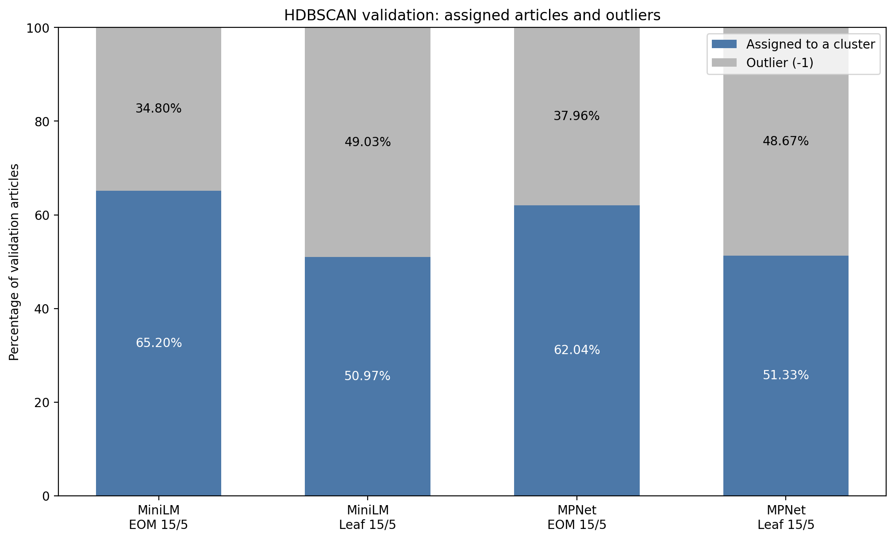
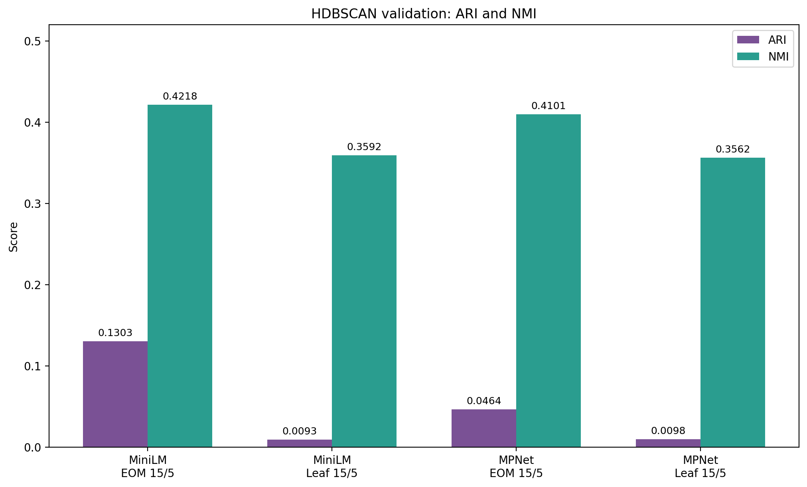

# E03 — Kết quả và thảo luận phương pháp Sentence Embedding + HDBSCAN

**Người phụ trách:** TV4 — Vân

**Phạm vi:** Đóng góp kết quả phương pháp Sentence Embedding + HDBSCAN cho phần so sánh năm phương pháp của nhóm.

## 1. Phạm vi đánh giá

Phần này sử dụng kết quả M10, M11, M12 và đánh giá HDBSCAN trên tập validation. Dữ liệu được chia theo split manifest của dự án: 6.493 bài train và 1.391 bài validation.

Hai mô hình biểu diễn được đưa vào so sánh validation là MiniLM và MPNet. Cả hai sử dụng cùng dạng đầu vào: tiêu đề đã xử lý kết hợp tối đa 60 từ đầu của nội dung đã xử lý. Với mỗi mô hình, phần đánh giá xét hai cấu hình HDBSCAN `eom_15_5` và `leaf_15_5`, tương ứng `min_cluster_size=15` và `min_samples=5`.

UMAP và HDBSCAN được fit trên train. Bài validation được mã hóa bằng cùng mô hình embedding, biến đổi bằng UMAP đã fit, sau đó gán cụm bằng `approximate_predict`. Không fit lại UMAP hoặc HDBSCAN trên validation. Nhãn train của các mô hình được tạo lại đã được kiểm tra khớp với assignments M11 trước khi dự đoán validation.

ARI và NMI được tính trên toàn bộ 1.391 bài validation, bao gồm cả những bài được gán nhãn `-1`. Nhãn `category_gold` là chuyên mục báo, chỉ được dùng làm nhãn tham khảo: một chuyên mục có thể chứa nhiều chủ đề và một chủ đề có thể xuất hiện trong nhiều chuyên mục.

## 2. Kết quả định lượng trên validation

Mỗi run dưới đây được đánh giá trên cùng 1.391 bài:

- **MiniLM + `eom_15_5`:** 484 bài nhiễu (`-1`), tỷ lệ nhiễu **34,80%**, độ bao phủ **65,20%**, ARI **0,1303**, NMI **0,4218**.
- **MiniLM + `leaf_15_5`:** 682 bài nhiễu, tỷ lệ nhiễu **49,03%**, độ bao phủ **50,97%**, ARI **0,0093**, NMI **0,3592**.
- **MPNet + `eom_15_5`:** 528 bài nhiễu, tỷ lệ nhiễu **37,96%**, độ bao phủ **62,04%**, ARI **0,0464**, NMI **0,4101**.
- **MPNet + `leaf_15_5`:** 677 bài nhiễu, tỷ lệ nhiễu **48,67%**, độ bao phủ **51,33%**, ARI **0,0098**, NMI **0,3562**.

Trong bốn run này, **MiniLM + `eom_15_5`** có ARI, NMI và độ bao phủ validation cao nhất. Ở cả MiniLM và MPNet, cấu hình EOM có tỷ lệ nhiễu thấp hơn và ARI cao hơn cấu hình Leaf tương ứng. Tuy nhiên, các chỉ số này chưa đủ để kết luận một run tạo ra các chủ đề dễ hiểu nhất; cần đối chiếu thêm nội dung các cụm và các trường hợp gán sai hoặc bị xem là nhiễu.

Kết quả gốc nằm trong `results/hdbscan/validation/m11_validation_metrics.csv`. Hai hình sau trình bày riêng tỷ lệ nhiễu/độ bao phủ và ARI/NMI để tránh đặt các đại lượng khác thang đo lên cùng một trục:

## 3. Kiểm tra định tính một cụm lớn

Để bổ sung cho các metric, tôi kiểm tra **cụm 1 của MiniLM + `eom_15_5`**. Cụm này có **854 bài train** và **194 bài validation** được gán vào cụm.

Trên train, 769/854 bài mang chuyên mục `Sức khỏe`; các bài còn lại thuộc `Giáo dục` (32), `Kinh doanh` (18), `Pháp luật` (14), `Giải trí` (11), `Khoa học công nghệ` (7) và `Thể thao` (3). Trên validation, 168/194 bài thuộc `Sức khỏe`. Đây là phân bố **chuyên mục**, không phải phép đo độ thuần nhất của chủ đề.

Tôi lấy mẫu thăm dò 20 bài train trong cụm: 10 bài thuộc chuyên mục `Sức khỏe` và 10 bài thuộc các chuyên mục khác, với `random_state=42`. Cách lấy mẫu này cố ý lấy nhiều bài ngoài chuyên mục Sức khỏe để khảo sát các ca khó, vì vậy không đại diện cho phân bố của toàn cụm.

### 3.1. Các bài thuộc chuyên mục Sức khỏe

Mẫu gồm nhiều nội dung liên quan sức khỏe nhưng thuộc các tiểu chủ đề khác nhau:

- `VNE_523ccd5eb7d3`: thiếu magie và căng thẳng.
- `VNN_4440e0c854fd`: ca chấn thương gãy đốt sống cổ.
- `VNE_bc79f69f8668`: bệnh nhược cơ và u tuyến ức.
- `TTR_fe3c27991f27`: dị vật trong tai và xử trí.
- `TTR_79b727e1c2a9`: quyền lợi và thanh toán bảo hiểm y tế.
- `TTR_b4ff72dc8081`: đề xuất điều chỉnh quyền lợi bảo hiểm y tế.

Những ví dụ này cho thấy cụm có một trục nội dung sức khỏe rõ ràng, nhưng gộp cả ca bệnh, dinh dưỡng, chăm sóc sức khỏe và chính sách y tế. Vì vậy, tên mô tả phù hợp ở mức rộng là **“sức khỏe và hoạt động y tế”**, chưa nên đặt tên như một bệnh hoặc một sự kiện cụ thể.

### 3.2. Các bài thuộc chuyên mục khác

Một số bài có chuyên mục khác nhưng nội dung vẫn liên quan trực tiếp đến sức khỏe hoặc ngành y:

- `VNN_b61414c05326` thuộc `Giải trí`, nhưng nội dung nói về tình trạng bệnh và điều trị của nghệ sĩ Bảo Bảo.
- `TTR_7333d205303c` thuộc `Giáo dục`, nhưng nội dung chính là hoạt động khám sức khỏe cho học sinh.
- `VNN_cc669b1fa701` thuộc `Giáo dục`, bàn về quản lý bệnh mạn tính.
- `TTR_0133b65c04fc` và `TTR_509e0124e2a8` nói về đào tạo, thực tập và lựa chọn chuyên ngành trong y khoa.

Cũng có những bài chỉ liên quan đến sức khỏe qua bối cảnh, trong khi trọng tâm thuộc chủ đề khác:

- `VNN_3bd4b407d1f7` thuộc `Giải trí`: bài chủ yếu nói về hoa hậu Tiểu Vy và công việc diễn xuất, dù có chi tiết liên quan bệnh viện.
- `VNN_2c32f8f61c08` thuộc `Kinh doanh`: trọng tâm là gói thầu tại bệnh viện.
- `TTR_9510582f215d` thuộc `Pháp luật`: trọng tâm là vụ án liên quan việc đưa heo bệnh vào giết mổ.

**Nhận xét từ mẫu:** Cụm 1 có chủ đề sức khỏe theo nghĩa rộng, nhưng ranh giới chưa chặt. Một phần khác biệt với `category_gold` là do bài báo thực sự giao thoa giữa nhiều chuyên mục; một phần là các bài chỉ có từ ngữ hoặc bối cảnh y tế nhưng trọng tâm nằm ngoài sức khỏe. Do mẫu được chọn để khảo sát các ca khó, kết quả này không được dùng để suy ra tỷ lệ gán sai của toàn cụm.

## 4. Liên hệ với phân tích outlier M12

M12 phân tích các bài được gán `-1` trên **train** và phân biệt các trường hợp `data_noise`, `rare_valid`, `multi_topic`, `valid_outlier` và `uncertain`. Kết quả đó giúp giải thích vì sao không thể xem toàn bộ bài nhiễu là dữ liệu lỗi, hoặc chọn cấu hình chỉ dựa vào tỷ lệ nhiễu thấp.

Bộ 60 trường hợp đã gán nhãn trong `results/hdbscan/outlier_analysis/m12_labeled_cases.csv` được lấy từ các run **MPNet trên train**. Bộ này không phải mẫu đánh giá định tính cho MiniLM trên validation. Khi tổng hợp E03, nhóm cần trình bày rõ sự khác nhau giữa hai nguồn bằng chứng:

1. **Validation:** ARI, NMI, tỷ lệ nhiễu và độ bao phủ của bốn run.
2. **Train:** Phân tích taxonomy outlier M12 và các ví dụ có bằng chứng.
3. **Đọc cụm:** Mẫu 20 bài trong cụm 1 MiniLM + EOM để kiểm tra khả năng diễn giải cụm.

## 5. Kết luận đóng góp cho bảng so sánh năm phương pháp

Trong phạm vi bốn run HDBSCAN đã đánh giá trên validation, **MiniLM + `eom_15_5` là ứng viên HDBSCAN mạnh nhất theo các chỉ số hiện có**: ARI 0,1303; NMI 0,4218; độ bao phủ 65,20%. Đánh giá định tính một cụm lớn cho thấy mô hình nhận ra một miền nội dung sức khỏe, song cụm còn rộng và chứa một số bài có trọng tâm thuộc giải trí, kinh doanh hoặc pháp luật.

Khi đưa kết quả vào bảng chung E03, cần giữ cùng split và cùng định nghĩa metric theo `docs/evaluation_protocol.md`. ARI/NMI dùng `category_gold` chỉ phản ánh mức phù hợp với chuyên mục báo; chúng không thay thế việc đọc nội dung để đánh giá chủ đề. Không so trực tiếp các metric nội tại được tính trên các không gian biểu diễn khác nhau. Phần này chưa cung cấp runtime đo theo một quy tắc chung, vì vậy không dùng runtime để xếp hạng năm phương pháp.

**Đề xuất cho thảo luận chung:** đưa MiniLM + `eom_15_5` làm đại diện HDBSCAN trong bảng validation hiện tại, đồng thời ghi rõ giới hạn về độ rộng của cụm, bài nhiễu và sự khác biệt giữa chuyên mục với chủ đề. Việc chọn phương pháp tốt nhất của toàn dự án cần dựa trên kết quả của cả năm phương pháp theo protocol chung và đánh giá thủ công của nhóm.

## 6. Nguồn kết quả và khả năng tái tạo

- Cấu hình và hướng dẫn embedding: `docs/m10_embeddings_guide.md`.
- Thí nghiệm HDBSCAN train: `docs/m11_hdbscan_guide.md`.
- Cách dự đoán và đánh giá validation: `docs/m11_validation_guide.md`.
- Bảng metric validation: `results/hdbscan/validation/m11_validation_metrics.csv`.
- Assignments validation: `results/hdbscan/validation/`.
- Phân tích outlier và ví dụ: `docs/m12_outlier_analysis.md`.
- Quy tắc so sánh chung: `docs/evaluation_protocol.md`.

Có thể tính lại bảng metric validation từ assignments bằng lệnh:

    python -B -m experiments.hdbscan.evaluate_m11_validation

Hai biểu đồ validation được tạo từ cùng bảng metric. Phần đọc cụm sử dụng `article_id` để ghép assignments với dữ liệu gốc, nhằm kiểm tra cả tiêu đề và nội dung bài.