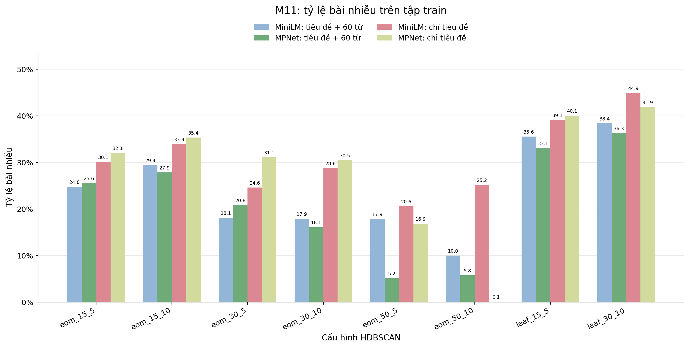
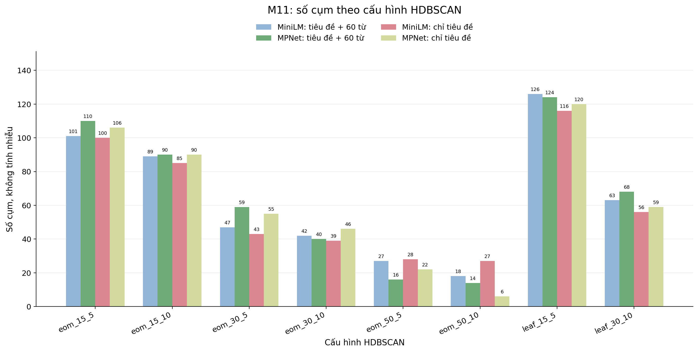
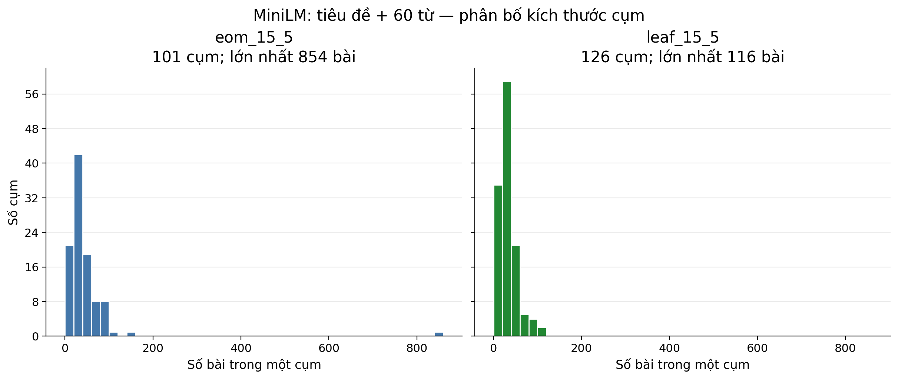
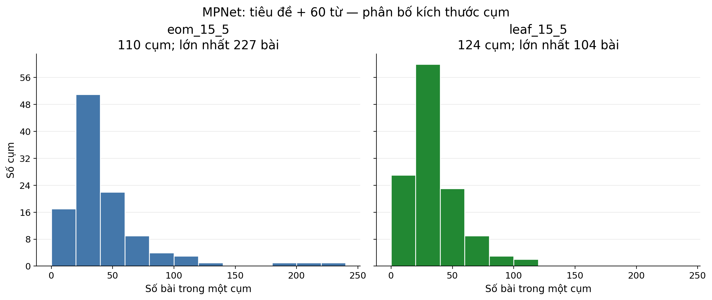
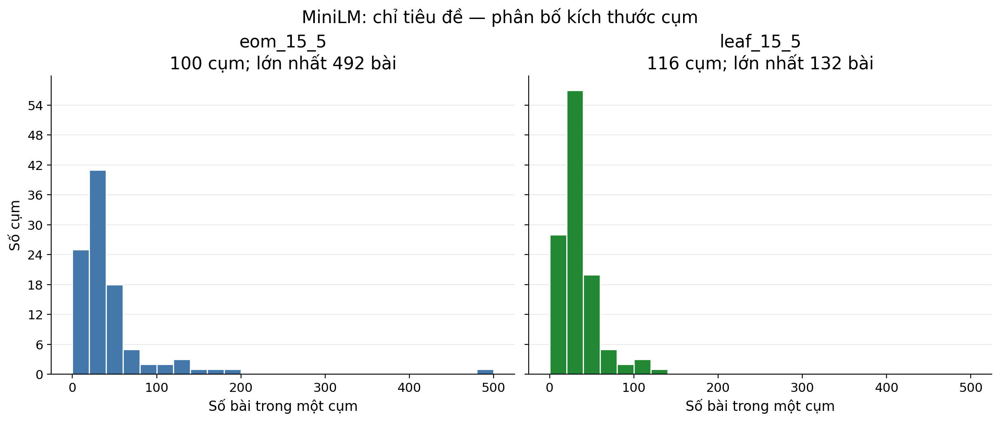
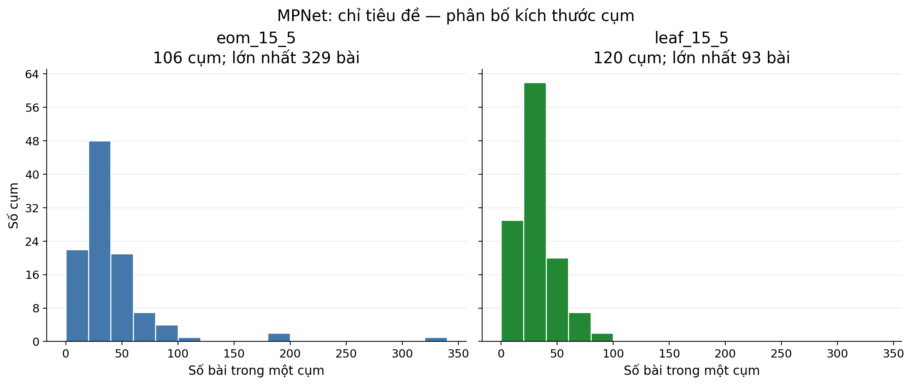
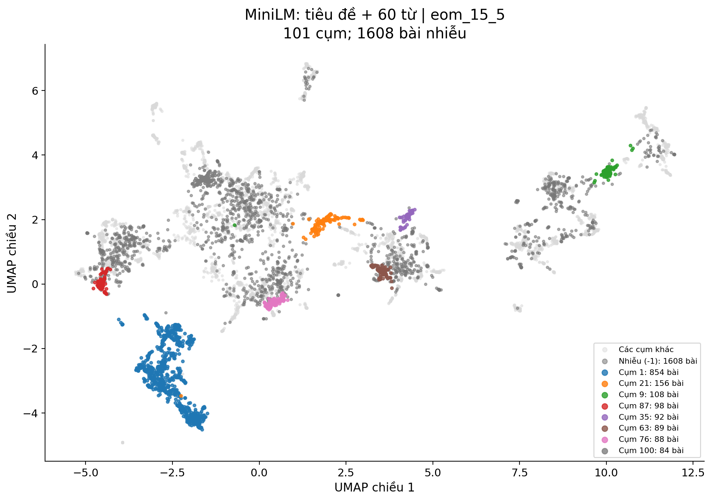
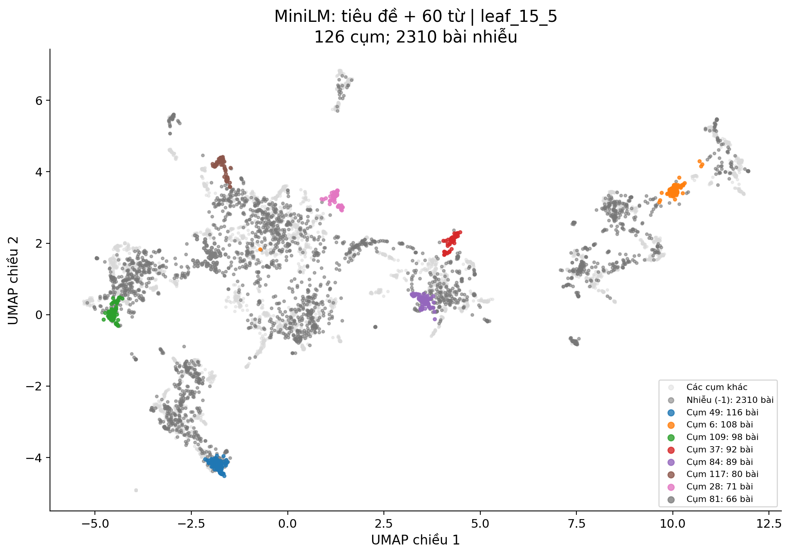
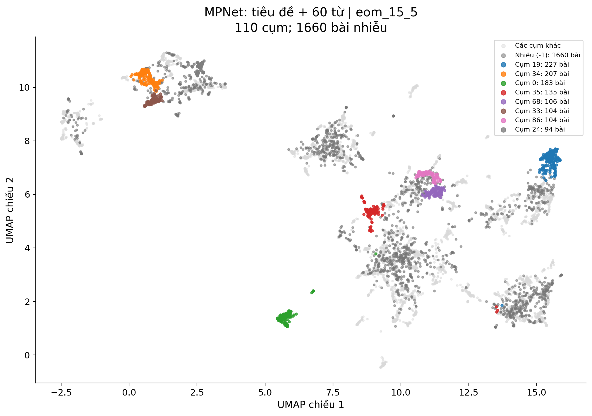
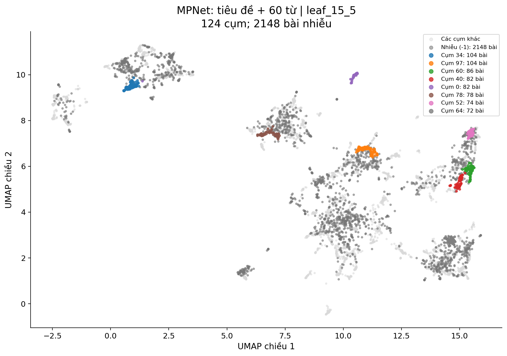

# Hướng dẫn HDBSCAN semantic clustering — Task M11

## 1. Mục tiêu

M11 thử nghiệm quy trình phân cụm ngữ nghĩa:

**Sentence embedding → UMAP 5 chiều → HDBSCAN**

Embedding được lấy từ bốn artifact M10. Mỗi bài báo nhận một nhãn cụm; nhãn `-1` biểu thị bài không được gán vào cụm trong lần chạy đó.

Thí nghiệm nhằm:

- So sánh MiniLM và MPNet.
- So sánh văn bản đầu vào chỉ có tiêu đề với tiêu đề cộng 60 từ đầu nội dung.
- Khảo sát `min_cluster_size`, `min_samples` và hai cách chọn cụm `eom`, `leaf`.
- Lưu nhãn cụm và thông tin cấu hình theo từng `article_id`.
- Kiểm tra tính đầy đủ và nhất quán của kết quả.

Theo phần phân công TV4, M11 tương ứng **mục 4.4 — HDBSCAN experiments**, với đầu ra là **clusters/outliers/configs**.

## 2. Các file chính

- `configs/hdbscan.yaml`: đường dẫn dữ liệu, embedding, tham số UMAP và HDBSCAN.
- `configs/embeddings.yaml`: cấu hình tạo embedding ở M10.
- `src/features/embeddings.py`: đọc artifact embedding và metadata.
- `src/models/hdbscan.py`: các hàm giảm chiều và phân cụm dùng chung.
- `experiments/hdbscan/run_m11_hdbscan.py`: chạy thí nghiệm và xuất CSV.
- `experiments/hdbscan/plot_m11_results.py`: tạo lại 10 hình kết quả M11.
- `tests/test_embeddings.py`: kiểm tra embedding M10.
- `tests/test_hdbscan.py`: kiểm tra hàm phân cụm.
- `tests/test_m11_outputs.py`: kiểm tra các CSV đầu ra M11.
- `docs/m11_hdbscan_guide.md`: hướng dẫn chạy và ghi nhận kết quả.

Runner giảm chiều **một lần cho mỗi embedding**, rồi dùng cùng ma trận 5 chiều để chạy tám cấu hình HDBSCAN. Nhờ vậy, tám cấu hình trên cùng một embedding được so sánh với cùng đầu vào đã giảm chiều.

## 3. Dữ liệu và embedding đầu vào

M11 sử dụng **Dataset v1.0**:

- File dữ liệu: `data/processed/p0_minimal.csv`.
- File chia tập: `data/splits/split_manifest.csv`.
- Tập sử dụng: `train`.
- Số bài: **6.493**.

Runner dùng `load_split_dataset()` để lấy tập train. Sau đó, runner đối chiếu số bài, `article_id` và thứ tự bài với artifact embedding.

| Embedding run | Văn bản đưa vào mô hình | Kích thước ma trận |
| --- | --- | ---: |
| `minilm_title_content` | Tiêu đề + 60 từ đầu nội dung | `6493 × 384` |
| `mpnet_title_content` | Tiêu đề + 60 từ đầu nội dung | `6493 × 768` |
| `minilm_title_only` | Chỉ tiêu đề | `6493 × 384` |
| `mpnet_title_only` | Chỉ tiêu đề | `6493 × 768` |

`title_content` dùng **60 từ đầu của nội dung**, không dùng toàn bộ bài báo. M11 đọc vector từ các file `.npz` của M10; runner M11 không tạo lại embedding.

Trước khi phân cụm, runner kiểm tra metadata của artifact với cấu hình M10, gồm tên run, mô hình, `content_words`, cột văn bản, tập dữ liệu và các thiết lập mã hóa.

## 4. Giảm chiều bằng UMAP

Tham số trong `configs/hdbscan.yaml`:

```yaml
umap:
  n_neighbors: 15
  n_components: 5
  min_dist: 0.0
  metric: "cosine"
  random_state: 42
```

UMAP chuyển vector embedding từ 384 hoặc 768 chiều xuống **5 chiều** để đưa vào HDBSCAN. File embedding M10 vẫn giữ số chiều gốc.

Mỗi embedding được giảm chiều riêng. Tám cấu hình HDBSCAN của cùng một embedding dùng chung kết quả UMAP 5 chiều.

Khi chạy, UMAP có thể hiện cảnh báo `n_jobs value 1 overridden to 1 by setting random_state`. Đây là cảnh báo về chạy song song khi đặt seed cố định, không phải thông báo thí nghiệm thất bại.

## 5. Cấu hình HDBSCAN

HDBSCAN sử dụng khoảng cách `euclidean` trên vector UMAP 5 chiều.

- `min_cluster_size`: kích thước tối thiểu của một cụm.
- `min_samples`: tham số ảnh hưởng tới mức độ chặt khi xác định vùng có đủ mật độ.
- `cluster_selection_method`: cách chọn cụm từ cấu trúc phân cấp, gồm `eom` và `leaf`.

| Cấu hình | `min_cluster_size` | `min_samples` | Cách chọn cụm |
| --- | ---: | ---: | --- |
| `eom_15_5` | 15 | 5 | `eom` |
| `eom_15_10` | 15 | 10 | `eom` |
| `eom_30_5` | 30 | 5 | `eom` |
| `eom_30_10` | 30 | 10 | `eom` |
| `eom_50_5` | 50 | 5 | `eom` |
| `eom_50_10` | 50 | 10 | `eom` |
| `leaf_15_5` | 15 | 5 | `leaf` |
| `leaf_30_10` | 30 | 10 | `leaf` |

Tổng cộng có **4 embedding × 8 cấu hình = 32 thí nghiệm**. Các giá trị này được dùng để khảo sát; kết quả M11 chưa chứng minh cấu hình nào là tối ưu.

## 6. Cách chạy phân cụm

Mở PowerShell tại thư mục gốc `vietnamese-news-topic-discovery`. Chạy từng lệnh và đợi lệnh hiện tại hoàn tất:

```powershell
python -B -m experiments.hdbscan.run_m11_hdbscan --embedding minilm_title_content
python -B -m experiments.hdbscan.run_m11_hdbscan --embedding mpnet_title_content
python -B -m experiments.hdbscan.run_m11_hdbscan --embedding minilm_title_only
python -B -m experiments.hdbscan.run_m11_hdbscan --embedding mpnet_title_only
```

Với mỗi embedding, runner:

1. Đọc cấu hình M10 và M11.
2. Kiểm tra bảng tổng hợp cũ nếu bảng đã tồn tại.
3. Đọc tập train và artifact embedding.
4. Kiểm tra metadata, số bài, kích thước vector và thứ tự `article_id`.
5. Chạy UMAP 5 chiều một lần.
6. Chạy tám cấu hình HDBSCAN trên cùng ma trận đã giảm chiều.
7. Lưu một file assignments cho embedding đó.
8. Cập nhật các dòng tương ứng trong bảng tổng hợp chung.

Nếu chạy lại một embedding, runner thay assignments và các dòng summary của embedding đó. Các dòng của embedding khác chỉ được giữ lại khi `config_hash` tương thích.

### Vai trò của `config_hash`

`config_hash` là mã SHA-256 tính từ cấu hình dataset M11, UMAP, HDBSCAN và metadata cấu hình của bốn embedding M10. Nó giúp phát hiện trường hợp gộp kết quả từ **các cấu hình thí nghiệm khác nhau** vào cùng một bảng summary.

Nếu summary cũ thiếu `config_hash` hoặc có hash khác, runner báo lỗi trước khi chạy UMAP.

`config_hash` nhận diện **cấu hình được khai báo**; nó không kiểm tra nội dung từng byte của dataset hay vector. Nếu dữ liệu hoặc embedding artifact thay đổi mà YAML không đổi, cần tạo lại các kết quả chịu ảnh hưởng và tránh trộn kết quả cũ với mới.

## 7. Kết quả CSV

`configs/hdbscan.yaml` đặt:

```yaml
output_dir: "results/hdbscan"
```

Sau khi chạy đủ bốn embedding, có năm CSV chính:

```text
results/hdbscan/
├── minilm_title_content_assignments.csv
├── mpnet_title_content_assignments.csv
├── minilm_title_only_assignments.csv
├── mpnet_title_only_assignments.csv
└── m11_summary.csv
```

### Bốn file assignments

Mỗi file có **6.493 bài × 8 cấu hình = 51.944 dòng dữ liệu**.

Các cột:

- `article_id`: mã bài báo.
- `cluster_id`: nhãn cụm; `-1` là bài nhiễu.
- `membership_strength`: mức độ thuộc cụm do HDBSCAN trả về.
- `model_name`: tên mô hình embedding.
- `data_version`: phiên bản dữ liệu.
- `embedding_run`: tên cấu hình embedding.
- `experiment`: tên cấu hình HDBSCAN.
- `config_hash`: mã nhận diện cấu hình thí nghiệm.

Một `article_id` xuất hiện tám lần trong cùng một file vì bài đó được phân cụm dưới tám cấu hình. Cặp `experiment` + `article_id` phải duy nhất.

`membership_strength` **không phải** độ chính xác của chủ đề. `cluster_id` chỉ có ý nghĩa **trong một run**: cụm `1` của EOM không mặc nhiên tương ứng với cụm `1` của Leaf hoặc của embedding khác.

### File `m11_summary.csv`

Bảng tổng hợp có **32 dòng dữ liệu**, mỗi dòng ứng với một embedding và một cấu hình HDBSCAN.

Các cột:

- `embedding_run`, `experiment`, `config_hash`: định danh run và cấu hình.
- `min_cluster_size`, `min_samples`, `cluster_selection_method`: tham số HDBSCAN.
- `n_articles`: số bài được phân cụm.
- `n_clusters`: số cụm, không tính nhãn `-1`.
- `n_noise`: số bài mang nhãn `-1`.
- `noise_percent`: tỷ lệ bài nhiễu.
- `smallest_cluster`, `largest_cluster`: kích thước cụm nhỏ nhất và lớn nhất.

M11 hiện lưu **nhãn phân cụm và số liệu thí nghiệm** trong CSV. Quy trình hiện tại chưa lưu mô hình UMAP hoặc HDBSCAN đã fit vào `artifacts/hdbscan/`.

## 8. Kiểm tra

Chạy test M10 và M11:

```powershell
python -B -m pytest -p no:cacheprovider tests/test_embeddings.py tests/test_hdbscan.py tests/test_m11_outputs.py -v
```

Lần kiểm tra đã ghi nhận **14 passed**, gồm:

- **5 test M10** trong `tests/test_embeddings.py`: kiểm tra số vector, thứ tự ID, NaN, ID trùng, dữ liệu P0 và lưu/tải vector cùng metadata.
- **4 test** trong `tests/test_hdbscan.py`: kiểm tra hàm giảm chiều, phân cụm và dữ liệu đầu vào không hợp lệ.
- **5 test đầu ra M11** trong `tests/test_m11_outputs.py`: kiểm tra 32 run, assignments, summary và `config_hash`.

Các test kiểm tra **tính đúng đắn của cấu trúc dữ liệu và cách ghép kết quả**; chúng không chứng minh mọi cụm đều có một chủ đề ngữ nghĩa rõ ràng.

## 9. Kết quả ở hai cấu hình được xem kỹ

Bảng dưới lấy từ `results/hdbscan/m11_summary.csv`. Mỗi run có **6.493 bài**.

| Embedding run | Cấu hình | Số cụm | Bài nhiễu | Tỷ lệ nhiễu | Cụm lớn nhất |
| --- | --- | ---: | ---: | ---: | ---: |
| `minilm_title_content` | `eom_15_5` | 101 | 1.608 | 24,77% | 854 |
| `minilm_title_content` | `leaf_15_5` | 126 | 2.310 | 35,58% | 116 |
| `mpnet_title_content` | `eom_15_5` | 110 | 1.660 | 25,57% | 227 |
| `mpnet_title_content` | `leaf_15_5` | 124 | 2.148 | 33,08% | 104 |
| `minilm_title_only` | `eom_15_5` | 100 | 1.956 | 30,12% | 492 |
| `minilm_title_only` | `leaf_15_5` | 116 | 2.540 | 39,12% | 132 |
| `mpnet_title_only` | `eom_15_5` | 106 | 2.082 | 32,07% | 329 |
| `mpnet_title_only` | `leaf_15_5` | 120 | 2.602 | 40,07% | 93 |

Ở cùng mô hình và cấu hình 15/5, `title_content` có tỷ lệ nhiễu thấp hơn `title_only` trong cả bốn cặp so sánh trên. Điều này **chưa đủ để kết luận** rằng thêm 60 từ làm chất lượng chủ đề tốt hơn; cần đọc nội dung các cụm và các ca outlier.

Với cả bốn embedding, Leaf ở tham số 15/5 tạo nhiều cụm hơn EOM và có tỷ lệ nhiễu cao hơn. Ở MiniLM `title_content`, EOM còn tạo một cụm rất lớn gồm **854 bài**. Cần đọc các bài trong cụm này để xem liệu nhiều chủ đề đã bị gom chung hay không.

### Nhận xét thủ công đã thực hiện

Trong mẫu tiêu đề đã xem của MPNet `title_content`:

- `eom_15_5`: cụm về thành tích thể thao Việt Nam tại ASIAD khá nhất quán. Một cụm sức khỏe rộng hơn, gồm cả dinh dưỡng và trị liệu tâm lý. Một cụm nhỏ về câu chuyện con người có dấu hiệu trộn các bài khác chủ đề.
- `leaf_15_5`: cụm bóng đá câu lạc bộ Việt Nam khá nhất quán. Cụm ngành điện trải rộng từ doanh nghiệp điện đến chính sách giá điện. Một cụm nhỏ vẫn có dấu hiệu trộn nội dung.

Đây là **nhận xét từ một số bài mẫu**, không phải đánh giá ngữ nghĩa đầy đủ của 32 run.

Tỷ lệ nhiễu thấp cũng không tự động là kết quả tốt. Ví dụ, MPNet `title_only` với `eom_50_10` có tỷ lệ nhiễu **0,11%**, nhưng cụm lớn nhất chứa **3.862 bài**. Cần xem nội dung trước khi đánh giá một cụm lớn như vậy.

Bài mang nhãn `-1` vẫn có thể là bài hợp lệ, chủ đề hiếm hoặc bài liên quan đến nhiều chủ đề. Nhãn nhiễu không tự động có nghĩa dữ liệu sai; việc phân tích từng trường hợp thuộc M12.

## 10. Biểu đồ kết quả

Chạy lệnh sau tại thư mục gốc đồ án để **tạo lại cả 10 hình** trong `results/hdbscan/figures/`:

```powershell
python -B -m experiments.hdbscan.plot_m11_results
```

Lệnh tạo hai hình tổng quan, bốn hình phân bố kích thước cụm và bốn hình UMAP 2D. Nó đọc kết quả M11 đã lưu và **không chạy lại HDBSCAN**. Bốn hình 2D tạo phép chiếu UMAP riêng để minh họa, sau đó tô màu bằng nhãn cụm đã lưu trong assignments.

Chạy lệnh này sẽ ghi lại các PNG cùng tên. Khi dùng `random_state` cố định, UMAP có thể hiện cảnh báo về `n_jobs`; nếu chương trình vẫn lưu đủ hình thì cảnh báo đó không phải lỗi.

### 10.1. Tỷ lệ bài nhiễu của 32 run



Hình so sánh cả bốn embedding trên tám cấu hình. Số trên cột được làm tròn đến **một chữ số thập phân**; CSV giữ tỷ lệ đến **hai chữ số thập phân**. Chẳng hạn **0,11%** trong CSV hiển thị thành **0,1%** trên hình.

### 10.2. Số cụm của 32 run



Trong các cấu hình EOM đã thử, tăng `min_cluster_size` từ 15 lên 50 trong khi giữ cùng `min_samples` làm số cụm giảm ở các kết quả hiện tại. Cần xem nội dung để biết các cụm còn giữ chủ đề rõ ràng hay đã bị gom quá rộng.

### 10.3. Phân bố kích thước cụm

Mỗi hình dưới đây so sánh `eom_15_5` và `leaf_15_5` của **cùng một embedding**. Nhãn `-1` không được tính là một cụm.

#### MiniLM — tiêu đề + 60 từ nội dung



EOM có **101 cụm**, cụm lớn nhất **854 bài**. Leaf có **126 cụm**, cụm lớn nhất **116 bài**. Cụm EOM 854 bài làm trục ngang trải rộng; phần lớn các cụm còn lại tập trung ở vùng kích thước nhỏ hơn.

#### MPNet — tiêu đề + 60 từ nội dung



EOM có **110 cụm**, cụm lớn nhất **227 bài**. Leaf có **124 cụm**, cụm lớn nhất **104 bài**.

#### MiniLM — chỉ tiêu đề



EOM có **100 cụm**, cụm lớn nhất **492 bài**. Leaf có **116 cụm**, cụm lớn nhất **132 bài**.

#### MPNet — chỉ tiêu đề



EOM có **106 cụm**, cụm lớn nhất **329 bài**. Leaf có **120 cụm**, cụm lớn nhất **93 bài**.

Các hình dùng khoảng chia kích thước cụm rộng **20 bài**. Phạm vi trục ngang có thể khác giữa các hình vì kích thước cụm lớn nhất khác nhau. Khi so sánh hai hình, cần đọc giá trị trên trục thay vì chỉ so sánh vị trí cột trên màn hình.

### 10.4. Minh họa cụm và bài nhiễu trên mặt phẳng 2D

Bốn hình sau gắn **nhãn HDBSCAN M11 đã có** vào vị trí bài báo trên phép chiếu UMAP **2 chiều**. Các cụm lớn được tô màu; các cụm còn lại và bài nhiễu được hiển thị bằng các sắc độ xám khác nhau.

#### MiniLM — tiêu đề + 60 từ nội dung





#### MPNet — tiêu đề + 60 từ nội dung





**Cách đọc hình 2D:**

- Mỗi điểm là một bài báo.
- Màu sắc phân biệt tám cụm lớn nhất của run được vẽ.
- Điểm `cluster_id == -1` là bài nhiễu; xem chú giải để phân biệt với các cụm không được tô màu nổi bật.
- Nhãn cụm đến từ HDBSCAN chạy **trên UMAP 5 chiều**. Phép chiếu 2 chiều chỉ dùng để vẽ và không thay đổi assignments.
- Vị trí, khoảng cách và sự chồng lấn trên mặt phẳng 2D chỉ mang tính minh họa. Không thể suy ra ranh giới chính xác của phân cụm 5 chiều từ hình này.
- Không đối chiếu trực tiếp vị trí điểm hoặc số `cluster_id` giữa hai embedding khác nhau.
- `cluster_id` là mã cụm, **chưa phải tên chủ đề**. Muốn gọi một cụm là “thể thao”, “giáo dục”... cần đọc bài đại diện trong cụm.

## 11. Giới hạn và công việc liên quan

M11 đã có:

- Bốn embedding từ M10 làm đầu vào.
- Tám cấu hình HDBSCAN cho mỗi embedding.
- Năm CSV chứa kết quả **32 thí nghiệm**.
- Nhãn cụm gắn với `article_id` và mã cấu hình.
- Script tạo lại **10 hình** từ CSV và embedding artifact đã lưu.
- Test cấu trúc dữ liệu và tính nhất quán đã đạt trong lần chạy ghi nhận.
- Nhận xét thủ công sơ bộ về một số cụm.

Số cụm, tỷ lệ nhiễu và kích thước cụm mô tả kết quả phân cụm nhưng **không đủ để kết luận chất lượng ngữ nghĩa**. Việc chọn cấu hình cuối cùng cần kiểm tra thêm nội dung các cụm và theo quy trình đánh giá chung của nhóm.

M11 đáp ứng phần thí nghiệm **mục 4.4**. Việc đọc bài nhiễu và phân biệt `data_noise`, `rare_valid`, `multi_topic`, `valid_outlier` được ghi riêng trong tài liệu **M12 — Outlier analysis**.