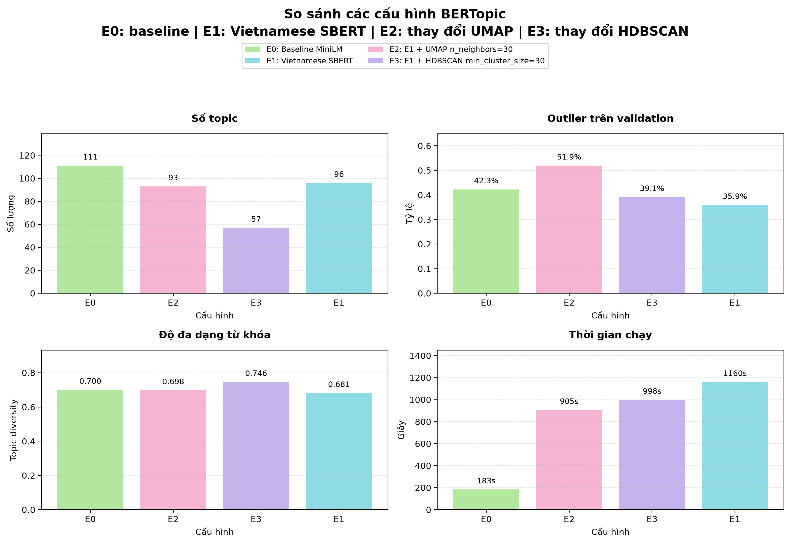
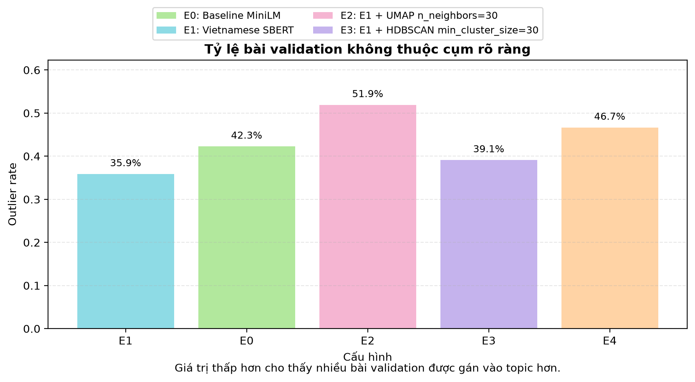
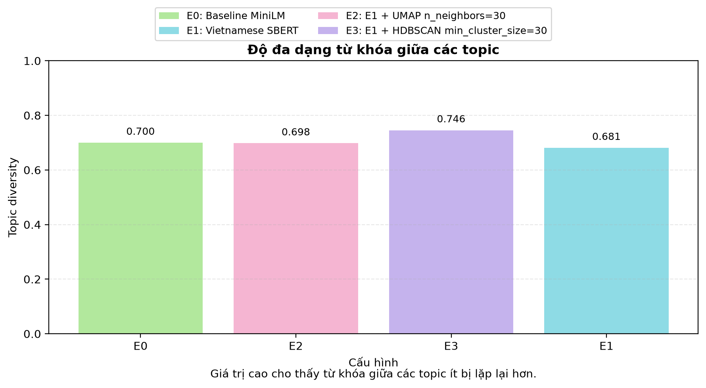
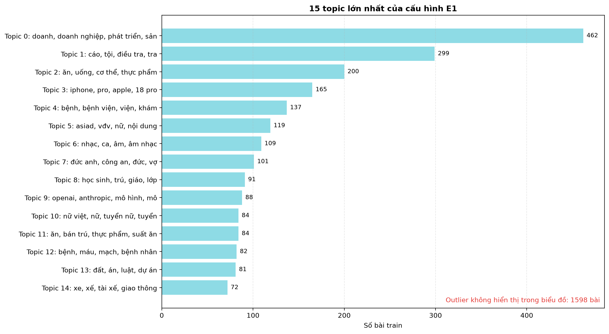
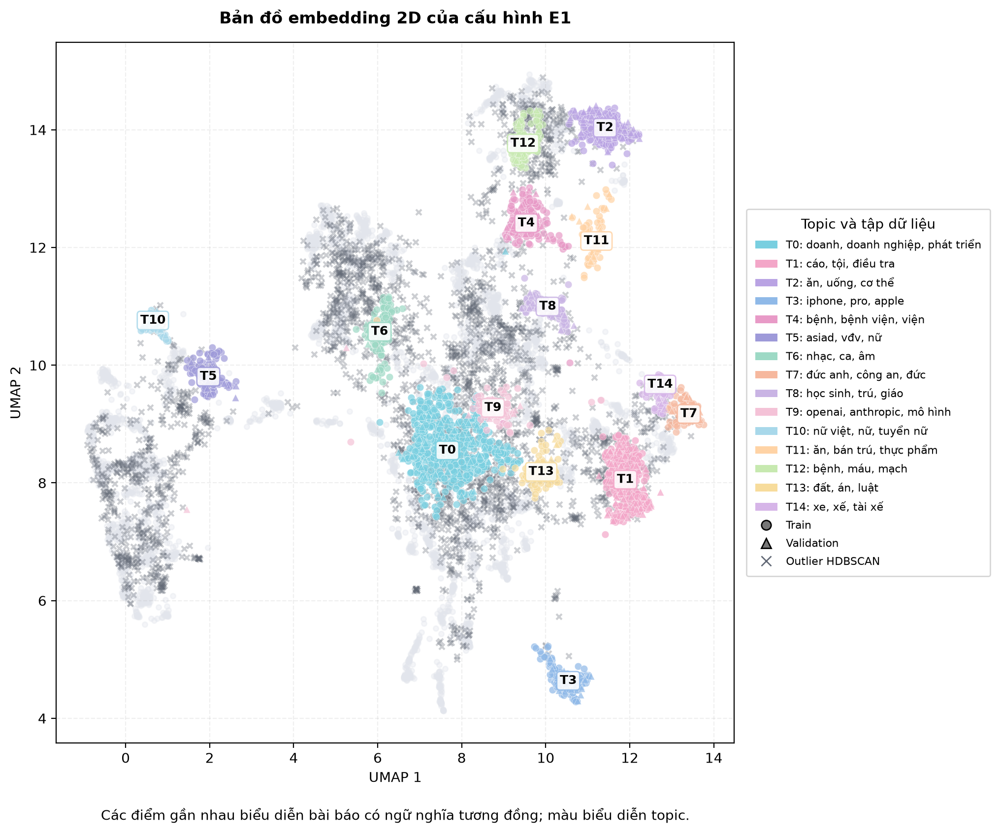
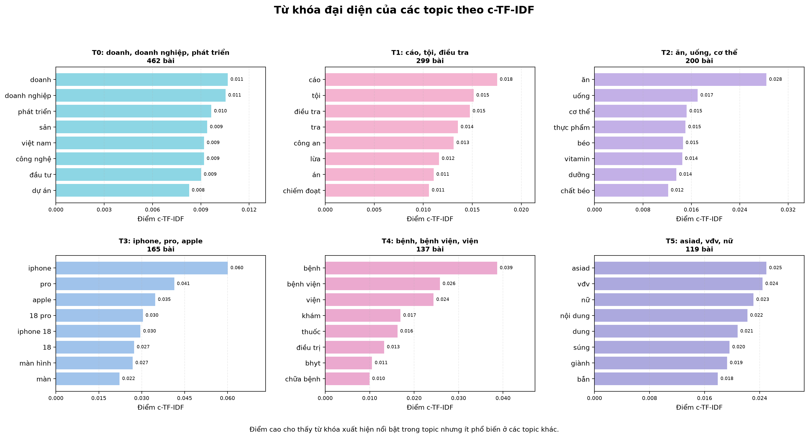
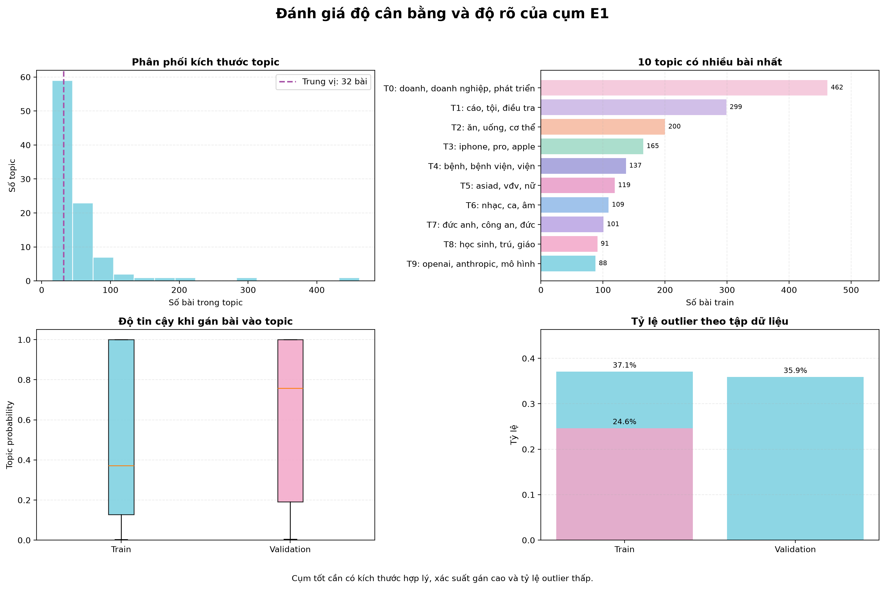

### 3.1 Embedding

Embedding mã hóa nội dung bài báo thành vector. Hai bài có ý nghĩa gần nhau được kỳ vọng có vector gần nhau, kể cả khi không dùng chính xác cùng một từ. Thí nghiệm so sánh embedding multilingual MiniLM với Vietnamese SBERT nhằm kiểm tra lợi ích của mô hình chuyên biệt cho tiếng Việt.

### 3.2 UMAP

Embedding ban đầu có nhiều chiều và không phù hợp để HDBSCAN xử lý trực tiếp. UMAP giảm số chiều nhưng cố gắng bảo toàn quan hệ lân cận. Tham số `n_neighbors` quyết định mức độ ưu tiên cấu trúc cục bộ hay cấu trúc rộng hơn.

UMAP 2D dùng để vẽ hình là một bước trực quan hóa riêng. Nó không thay thế và không làm thay đổi UMAP dùng trong pipeline phân cụm.

### 3.3 HDBSCAN

HDBSCAN tạo cụm dựa trên mật độ và không yêu cầu chỉ định trước số topic. Các điểm không nằm trong vùng đủ mật độ được gán topic `-1`. Đây là cơ chế phát hiện outlier, không phải lỗi dữ liệu.

### 3.4 c-TF-IDF

c-TF-IDF xem toàn bộ tài liệu trong một topic như một lớp văn bản. Một từ có điểm cao khi xuất hiện nổi bật trong topic đó nhưng ít phổ biến ở các topic khác. Vì vậy c-TF-IDF là lớp giải thích giúp con người hiểu nội dung cụm do HDBSCAN tạo ra.

## 4. Thiết kế thí nghiệm E0–E3

Các thí nghiệm chỉ thay đổi một thành phần chính ở mỗi lần chạy để kết quả có thể so sánh:

| Cấu hình | Embedding | Thay đổi chính | Mục đích |
|---|---|---|---|
| E0 | Multilingual MiniLM | Baseline | Làm mốc so sánh |
| E1 | Vietnamese SBERT | Đổi embedding | Kiểm tra mô hình chuyên cho tiếng Việt |
| E2 | Vietnamese SBERT | `UMAP n_neighbors = 30` | Kiểm tra ảnh hưởng của lân cận UMAP |
| E3 | Vietnamese SBERT | `HDBSCAN min_cluster_size = 30` | Kiểm tra ảnh hưởng của kích thước cụm tối thiểu |

Các cấu hình còn lại được giữ cố định trong từng nhóm so sánh.

## 5. Kết quả so sánh



| Cấu hình | Số topic | Outlier train | Outlier validation | Topic diversity | Thời gian |
|---|---:|---:|---:|---:|---:|
| E0 | 111 | 31,14% | 42,27% | 0,700 | 183,30 giây |
| E1 | 96 | **24,61%** | **35,87%** | 0,681 | 1.159,69 giây |
| E2 | 93 | 33,61% | 51,91% | 0,698 | 905,39 giây |
| E3 | 57 | 29,59% | 39,11% | **0,746** | 997,85 giây |

### Nhận xét

- **E1 có tỷ lệ outlier thấp nhất** trên cả train và validation. Điều này cho thấy Vietnamese SBERT giúp nhiều bài được đặt vào các vùng cụm rõ ràng hơn trong thiết lập hiện tại.
- **E3 có topic diversity cao nhất** và số topic thấp nhất. Khi tăng kích thước cụm tối thiểu, mô hình tạo ít cụm hơn và từ khóa giữa các cụm ít lặp hơn.
- **E2 không cải thiện kết quả** trong lần thử này: outlier validation tăng lên 51,91%.
- **E0 chạy nhanh nhất**, nhưng có outlier validation cao hơn E1.
- **E1 không tốt nhất trên mọi chỉ số**. Cấu hình này được chọn làm cấu hình phân tích chính vì ưu tiên độ phủ cụm trên validation, không phải vì có diversity hay tốc độ tốt nhất.





## 6. Kích thước và nội dung topic của E1



E1 tạo **96 topic**. Topic 0 có 462 bài, tương đương khoảng 7,12% tập train, và liên quan nhiều đến doanh nghiệp, phát triển, đầu tư và kinh doanh. Một số topic lớn khác có nội dung tương đối rõ:

- T1: pháp luật, cáo buộc và điều tra;
- T2: ăn uống, cơ thể và sức khỏe;
- T3: iPhone, Apple và thiết bị công nghệ;
- T4: bệnh, bệnh viện và điều trị;
- T5: ASIAD, vận động viên và thể thao nữ;
- T6: âm nhạc, ca hát và giải trí;
- T8: học sinh, nhà trường và giáo dục;
- T9: OpenAI, Anthropic và mô hình AI.

Kích thước topic không đồng đều là hiện tượng bình thường trong dữ liệu tin tức thực tế. Tuy nhiên, topic quá lớn có thể chứa nhiều chủ đề con, còn topic quá nhỏ có thể thiếu ổn định và cần được kiểm tra thủ công.

## 7. Bản đồ embedding 2D



Mỗi điểm trong hình là một bài báo. Khoảng cách trong hình 2D là xấp xỉ quan hệ ngữ nghĩa sau khi UMAP giảm chiều:

- các điểm gần nhau thường có nội dung tương tự;
- màu sắc biểu diễn 15 topic lớn nhất;
- hình tròn biểu diễn train, hình tam giác biểu diễn validation;
- dấu `x` biểu diễn outlier do HDBSCAN gán `-1`;
- các topic nhỏ ngoài top 15 được vẽ bằng màu nhạt để tránh legend quá dài.

Nhiều cụm màu tạo thành vùng tương đối riêng, ví dụ T3 nằm tách ở phía dưới và T2 nằm ở vùng phía trên. Một số cụm nằm gần hoặc xen lẫn nhau, cho thấy ranh giới ngữ nghĩa giữa các chủ đề tin tức không phải lúc nào cũng tuyệt đối. Hình 2D chỉ dùng để giải thích trực quan; không nên đánh giá toàn bộ chất lượng mô hình chỉ từ khoảng cách trên hình này.

## 8. Từ khóa đại diện theo c-TF-IDF



Biểu đồ trình bày các từ có điểm c-TF-IDF cao nhất ở những topic lớn. Thanh dài hơn cho biết từ có tính đại diện mạnh hơn cho topic tương ứng.

Ví dụ:

- T1 có các từ `cáo`, `tội`, `điều tra`, `công an`, phù hợp nhóm tin pháp luật;
- T2 có `ăn`, `uống`, `cơ thể`, `thực phẩm`, phù hợp nhóm sức khỏe và dinh dưỡng;
- T3 có `iphone`, `pro`, `apple`, phù hợp nhóm sản phẩm công nghệ;
- T4 có `bệnh`, `bệnh viện`, `khám`, `thuốc`, phù hợp nhóm y tế;
- T5 có `asiad`, `vđv`, `nữ`, phù hợp nhóm thể thao.

Một số từ còn bị tách hoặc chưa tự nhiên, chẳng hạn `doanh`, `mô`, `dung`. Đây là dấu hiệu cho thấy bước chuẩn hóa và biểu diễn từ tiếng Việt vẫn có thể được cải tiến.

## 9. Đánh giá độ cân bằng và độ rõ của cụm



Dashboard đánh giá bốn khía cạnh:

1. **Phân phối kích thước topic:** cho biết phần lớn topic có quy mô bao nhiêu và có topic quá lớn hay không.
2. **Các topic lớn nhất:** giúp nhận diện cụm chi phối dữ liệu.
3. **Topic probability:** so sánh độ tin cậy khi gán topic giữa train và validation.
4. **Outlier rate:** đo tỷ lệ bài không thuộc cụm rõ ràng ở từng split.

Outlier validation của E1 là 35,87%, cao hơn outlier train 24,61%. Khoảng cách này cho thấy cấu trúc cụm học từ train chưa bao phủ hoàn toàn các bài validation. Đây là hạn chế cần được trình bày thay vì chỉ báo cáo các topic đẹp.

## 10. Các file kết quả

| File | Ý nghĩa |
|---|---|
| `metrics.json` | Chỉ số tổng hợp của một lần chạy |
| `config_used.yaml` | Cấu hình thực tế đã sử dụng |
| `topic_info.csv` | Thông tin topic do BERTopic xuất |
| `document_topics.csv` | Topic, xác suất và trạng thái outlier của từng bài |
| `embedding_projection.csv` | Tọa độ UMAP 2D của từng bài để trực quan hóa |
| `topic_keywords.csv` | Từ khóa và điểm c-TF-IDF theo topic |
| `topic_summary.csv` | Kích thước, từ khóa, tiêu đề đại diện và nhãn chi phối của topic |
| `summary.csv` | Bảng so sánh E0–E3 |

Các file CSV giúp kết quả có thể kiểm tra ở mức từng bài báo thay vì chỉ tồn tại dưới dạng hình ảnh.

## 11. Kiểm thử

Các test bao phủ:

- cấu hình và thành phần pipeline BERTopic;
- việc encode và fit bằng embedding tương ứng;
- tính outlier rate và topic diversity;
- xuất topic assignment, từ khóa, topic summary và embedding projection;
- tạo các biểu đồ đánh giá;
- kiểm tra thiết kế thí nghiệm E0–E3.

Kết quả hiện tại:

```text
33 passed in 38.81s
```

## 12. Kết luận

Pipeline đã hoàn thành luồng từ dữ liệu tin tức tiếng Việt đến embedding, giảm chiều, phân cụm, giải thích topic, đánh giá và trực quan hóa. Vietnamese SBERT trong E1 đạt outlier validation thấp nhất trong bốn cấu hình, vì vậy được chọn làm cấu hình chính để phân tích sâu.

Kết quả cho thấy nhiều topic có nội dung rõ và phù hợp với các nhóm tin như pháp luật, sức khỏe, công nghệ, thể thao và giáo dục. Tuy nhiên, mô hình vẫn có tỷ lệ outlier validation đáng kể, kích thước cụm không đồng đều và một số từ khóa chưa tự nhiên.

## 13. Hướng cải tiến

- đánh giá thêm topic coherence thay vì chỉ dùng topic diversity;
- thử thêm embedding tiếng Việt hoặc embedding đa ngôn ngữ mới;
- khảo sát có hệ thống các tham số UMAP và HDBSCAN;
- cải thiện tách từ và chuẩn hóa cụm từ tiếng Việt;
- kiểm tra thủ công một mẫu bài trong mỗi topic;
- xem xét gộp các topic gần nhau hoặc tách topic quá lớn;