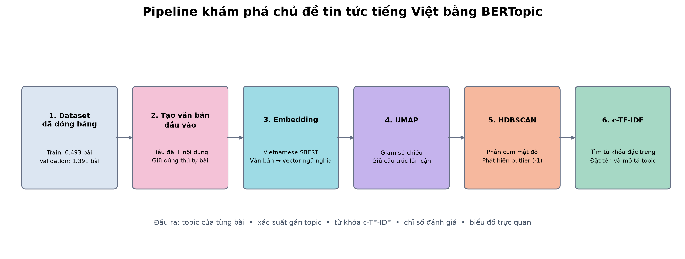

# M14 – Thí nghiệm và trực quan hóa BERTopic

## 1. Mục tiêu

M14 xây dựng và đánh giá pipeline khám phá chủ đề trên tập tin tức tiếng Việt đã được đóng băng ở các bước dữ liệu trước đó. Mục tiêu chính gồm:

- biểu diễn nội dung bài báo dưới dạng embedding ngữ nghĩa;
- tự động gom các bài có nội dung gần nhau thành topic mà không cần nhãn khi huấn luyện;
- phát hiện các bài không thuộc cụm rõ ràng;
- dùng c-TF-IDF để tìm từ khóa giải thích từng topic;
- so sánh có kiểm soát các lựa chọn embedding, UMAP và HDBSCAN;
- xuất dữ liệu trung gian và hình trực quan để kết quả có thể kiểm tra, giải thích và tái sử dụng.

Tập dữ liệu chính thức gồm **6.493 bài train** và **1.391 bài validation**. Tập test không được sử dụng để lựa chọn cấu hình.

## 2. Pipeline BERTopic

Pipeline gồm sáu bước:

1. **Dataset đã đóng băng:** sử dụng đúng split train và validation chính thức.
2. **Tạo văn bản đầu vào:** ghép tiêu đề và nội dung đã xử lý, đồng thời giữ nguyên thứ tự bài báo.
3. **Embedding:** chuyển mỗi bài báo thành vector ngữ nghĩa bằng Sentence Transformer.
4. **UMAP:** giảm chiều embedding, cố gắng giữ cấu trúc lân cận để hỗ trợ phân cụm.
5. **HDBSCAN:** tìm các vùng có mật độ cao để tạo cụm và gán `-1` cho các bài không thuộc cụm rõ ràng.
6. **c-TF-IDF:** tìm các từ nổi bật trong từng cụm để mô tả và đặt tên topic.

Đầu ra không chỉ là mô hình mà còn gồm topic của từng bài, xác suất gán topic, từ khóa đại diện, bảng tổng hợp topic, chỉ số đánh giá và các hình trực quan.

## 3. Vai trò của các thành phần

### 3.1 Embedding

Embedding mã hóa nội dung bài báo thành vector. Hai bài có ý nghĩa gần nhau được kỳ vọng có vector gần nhau, kể cả khi không dùng chính xác cùng một từ. Thí nghiệm so sánh embedding multilingual MiniLM với Vietnamese SBERT nhằm kiểm tra lợi ích của mô hình chuyên biệt cho tiếng Việt.

### 3.2 UMAP

Embedding ban đầu có nhiều chiều và không phù hợp để HDBSCAN xử lý trực tiếp. UMAP giảm số chiều nhưng cố gắng bảo toàn quan hệ lân cận. Tham số `n_neighbors` quyết định mức độ ưu tiên cấu trúc cục bộ hay cấu trúc rộng hơn.

UMAP 2D dùng để vẽ hình là một bước trực quan hóa riêng. Nó không thay thế và không làm thay đổi UMAP dùng trong pipeline phân cụm.

### 3.3 HDBSCAN

HDBSCAN tạo cụm dựa trên mật độ và không yêu cầu chỉ định trước số topic. Các điểm không nằm trong vùng đủ mật độ được gán topic `-1`. Đây là cơ chế phát hiện outlier, không phải lỗi dữ liệu.

### 3.4 c-TF-IDF

c-TF-IDF xem toàn bộ tài liệu trong một topic như một lớp văn bản. Một từ có điểm cao khi xuất hiện nổi bật trong topic đó nhưng ít phổ biến ở các topic khác. Vì vậy c-TF-IDF là lớp giải thích giúp con người hiểu nội dung cụm do HDBSCAN tạo ra.

## 4. Thiết kế thí nghiệm E0–E3

Các thí nghiệm chỉ thay đổi một thành phần chính ở mỗi lần chạy để kết quả có thể so sánh:

| Cấu hình | Embedding | Thay đổi chính | Mục đích |
|---|---|---|---|
| E0 | Multilingual MiniLM | Baseline | Làm mốc so sánh |
| E1 | Vietnamese SBERT | Đổi embedding | Kiểm tra mô hình chuyên cho tiếng Việt |
| E2 | Vietnamese SBERT | `UMAP n_neighbors = 30` | Kiểm tra ảnh hưởng của lân cận UMAP |
| E3 | Vietnamese SBERT | `HDBSCAN min_cluster_size = 30` | Kiểm tra ảnh hưởng của kích thước cụm tối thiểu |

Các cấu hình còn lại được giữ cố định trong từng nhóm so sánh.

## 5. Kết quả so sánh

| Cấu hình | Số topic | Outlier train | Outlier validation | Topic diversity | Thời gian |
|---|---:|---:|---:|---:|---:|
| E0 | 111 | 31,14% | 42,27% | 0,700 | 183,30 giây |
| E1 | 96 | **24,61%** | **35,87%** | 0,681 | 1.159,69 giây |
| E2 | 93 | 33,61% | 51,91% | 0,698 | 905,39 giây |
| E3 | 57 | 29,59% | 39,11% | **0,746** | 997,85 giây |

### Nhận xét

- **E1 có tỷ lệ outlier thấp nhất** trên cả train và validation. Điều này cho thấy Vietnamese SBERT giúp nhiều bài được đặt vào các vùng cụm rõ ràng hơn trong thiết lập hiện tại.
- **E3 có topic diversity cao nhất** và số topic thấp nhất. Khi tăng kích thước cụm tối thiểu, mô hình tạo ít cụm hơn và từ khóa giữa các cụm ít lặp hơn.
- **E2 không cải thiện kết quả** trong lần thử này: outlier validation tăng lên 51,91%.
- **E0 chạy nhanh nhất**, nhưng có outlier validation cao hơn E1.
- **E1 không tốt nhất trên mọi chỉ số**. Cấu hình này được chọn làm cấu hình phân tích chính vì ưu tiên độ phủ cụm trên validation, không phải vì có diversity hay tốc độ tốt nhất.

## 6. Kích thước và nội dung topic của E1

E1 tạo **96 topic**. Topic 0 có 462 bài, tương đương khoảng 7,12% tập train, và liên quan nhiều đến doanh nghiệp, phát triển, đầu tư và kinh doanh. Một số topic lớn khác có nội dung tương đối rõ:

- T1: pháp luật, cáo buộc và điều tra;
- T2: ăn uống, cơ thể và sức khỏe;
- T3: iPhone, Apple và thiết bị công nghệ;
- T4: bệnh, bệnh viện và điều trị;
- T5: ASIAD, vận động viên và thể thao nữ;
- T6: âm nhạc, ca hát và giải trí;
- T8: học sinh, nhà trường và giáo dục;
- T9: OpenAI, Anthropic và mô hình AI.

Kích thước topic không đồng đều là hiện tượng bình thường trong dữ liệu tin tức thực tế. Tuy nhiên, topic quá lớn có thể chứa nhiều chủ đề con, còn topic quá nhỏ có thể thiếu ổn định và cần được kiểm tra thủ công.

## 7. Bản đồ embedding 2D

Mỗi điểm trong hình là một bài báo. Khoảng cách trong hình 2D là xấp xỉ quan hệ ngữ nghĩa sau khi UMAP giảm chiều:

- các điểm gần nhau thường có nội dung tương tự;
- màu sắc biểu diễn 15 topic lớn nhất;
- hình tròn biểu diễn train, hình tam giác biểu diễn validation;
- dấu `x` biểu diễn outlier do HDBSCAN gán `-1`;
- các topic nhỏ ngoài top 15 được vẽ bằng màu nhạt để tránh legend quá dài.

Nhiều cụm màu tạo thành vùng tương đối riêng, ví dụ T3 nằm tách ở phía dưới và T2 nằm ở vùng phía trên. Một số cụm nằm gần hoặc xen lẫn nhau, cho thấy ranh giới ngữ nghĩa giữa các chủ đề tin tức không phải lúc nào cũng tuyệt đối. Hình 2D chỉ dùng để giải thích trực quan; không nên đánh giá toàn bộ chất lượng mô hình chỉ từ khoảng cách trên hình này.

## 8. Từ khóa đại diện theo c-TF-IDF

Biểu đồ trình bày các từ có điểm c-TF-IDF cao nhất ở những topic lớn. Thanh dài hơn cho biết từ có tính đại diện mạnh hơn cho topic tương ứng.

Ví dụ:

- T1 có các từ `cáo`, `tội`, `điều tra`, `công an`, phù hợp nhóm tin pháp luật;
- T2 có `ăn`, `uống`, `cơ thể`, `thực phẩm`, phù hợp nhóm sức khỏe và dinh dưỡng;
- T3 có `iphone`, `pro`, `apple`, phù hợp nhóm sản phẩm công nghệ;