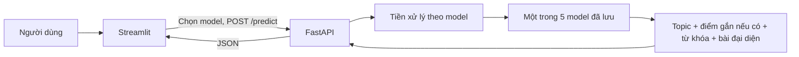

# P10A — Internal Inference API

## Mục tiêu

API nội bộ kết nối giao diện Streamlit với năm pipeline đã lưu. API chỉ
suy diễn bài báo mới, không huấn luyện lại mô hình và không phụ thuộc dịch vụ AI
bên ngoài.

## Kiến trúc



Các thành phần chính:

- `app/views/articles.py`: biểu mẫu nhập bài, gọi API và hiển thị kết quả.
- `src/api/main.py`: khai báo endpoint và chuyển lỗi thành HTTP response.
- `src/api/inference_service.py`: nạp model một lần, tiền xử lý và suy diễn.
- `src/api/schemas.py`: định nghĩa request/response chuẩn bằng Pydantic.
- `artifacts/`: model và common artifact của từng phương pháp.

## Endpoint

| Phương thức | Endpoint | Chức năng |
|---|---|---|
| `GET` | `/health` | Kiểm tra API đang hoạt động |
| `GET` | `/topics?model=bertopic` | Liệt kê topic của một mô hình |
| `POST` | `/predict` | Gán topic cho tiêu đề/nội dung mới |

Request mẫu:

```json
{
  "title": "Giá vàng tiếp tục tăng",
  "content": "Giá vàng trong nước tăng theo thị trường thế giới...",
  "model": "bertopic"
}
```

Response gồm `model`, `run_id`, `topic_id`, `topic_name`, `is_outlier`,
`confidence`, `keywords`, `representative_articles`, `inference_seconds`,
`preprocessing_variant` và `inference_mode`.

## Trình tự suy diễn

1. Xác thực request có tiêu đề hoặc nội dung và nằm trong giới hạn độ dài.
2. Áp dụng biến thể tiền xử lý tương ứng: BERTopic P1, HDBSCAN P0,
   K-Means/LDA P2, NMF P3.
3. Gọi pipeline đã lưu: BERTopic `transform`, HDBSCAN `approximate_predict`,
   hoặc `predict/transform` của KMeans, NMF, LDA; không fit lại.
4. Tra nhãn hiển thị, từ khóa và bài đại diện từ common artifact.
5. Trả JSON chuẩn cho Streamlit.

## Giới hạn

- `model` nhận `bertopic`, `hdbscan`, `kmeans`, `nmf`, `lda`; mặc định BERTopic E1.
- Các model được tải khi gọi lần đầu. HDBSCAN cần encoder MiniLM có sẵn trong
  cache hoặc mạng để tải lần đầu. API trả 503 nếu thiếu artifact/dependency.
- `confidence` của KMeans là `null` vì khoảng cách tới tâm cụm không phải
  xác suất. Score của các phương pháp còn lại cũng không được hiểu là xác suất
  đúng đã hiệu chỉnh.
- Lần gọi đầu có thể chậm do nạp model; các lần sau tái sử dụng cùng service.
- BERTopic/HDBSCAN có thể trả nhãn `-1`; K-Means/NMF/LDA luôn gán một topic.
- Tên topic NMF trong common artifact hiện còn dạng `Topic N`, cần nhóm duyệt
  mapping tên trước khi dùng làm nhãn trình bày chính thức.
- Bảng so sánh trên Streamlit vẫn đọc artifact; endpoint `/predict` mới cho phép
  chọn từng mô hình để suy diễn bài mới.

## Chạy và kiểm thử

Chạy test trước. Sau đó mở API và Streamlit trong hai terminal riêng:

```powershell
.\.venv\Scripts\python.exe -m pytest tests\test_api.py -q
# Terminal 1
.\.venv\Scripts\python.exe -m uvicorn src.api.main:app --host 127.0.0.1 --port 8001
# Terminal 2
$env:API_BASE_URL = "http://127.0.0.1:8001"
.\.venv\Scripts\python.exe -m streamlit run app\streamlit_app.py
```
