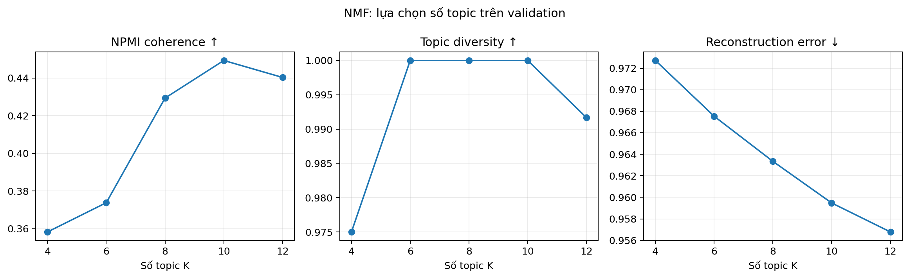
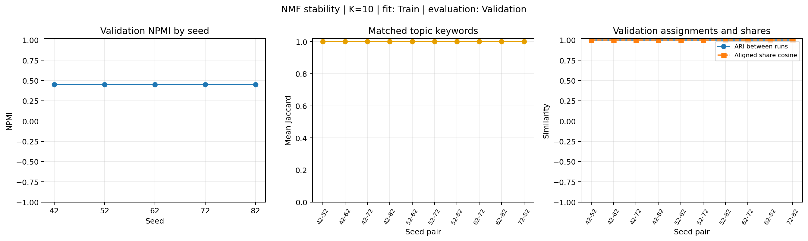

# TV2 — NMF: Methodology, Results và Discussion

## 1. Phương pháp NMF (Methodology)

Thí nghiệm NMF sử dụng Dataset v1.0 gồm 9.274 bài báo tiếng Việt sau khử trùng lặp. Dữ liệu đầu vào là biến thể tiền xử lý P3 (`p3_no_stopwords`), gồm chuẩn hóa văn bản, tách từ bằng PyVi và loại stopword. Trường `text` kết hợp tiêu đề với nội dung bài đã tiền xử lý. Các bài được nối với phân hoạch cố định thông qua `article_id`: 6.493 bài Train, 1.391 bài Validation và 1.390 bài Test.

Văn bản được biểu diễn bằng TF-IDF gồm unigram và bigram, tối đa 50.000 feature, `min_df=3`, `max_df=0.95` và `sublinear_tf=true`. Vectorizer được khớp trên Train rồi dùng để biến đổi Validation và Test. Cách làm này giữ thông tin từ hai tập đánh giá ngoài bước học từ vựng.

Non-negative Matrix Factorization (NMF) phân rã ma trận bài–từ không âm X thành hai ma trận không âm W và H, sao cho X được xấp xỉ bởi W × H. X có D hàng là bài báo và V cột là feature; W có kích thước D × K, còn H có kích thước K × V. W[d,k] biểu thị mức đóng góp của chủ đề k vào bài d, trong khi H[k,v] biểu thị mức đóng góp của feature v vào chủ đề k. Mô hình tối thiểu hóa một nửa bình phương sai số Frobenius giữa X và W × H. Sai số Frobenius là căn bậc hai của tổng bình phương chênh lệch giữa các phần tử tương ứng của hai ma trận. Tính không âm khiến phép tái tạo có tính cộng, nhờ đó một bài có thể nhận trọng số từ nhiều chủ đề (Lee & Seung, 1999).

Mô hình được khởi tạo bằng `nndsvda`, tối ưu bằng Coordinate Descent với hàm mất mát Frobenius, tối đa 500 vòng lặp và tolerance 0,0001. Thí nghiệm lựa chọn K và mô hình Final sử dụng seed 42; đánh giá stability bổ sung giữ K=10 và lặp lại với năm seed 42, 52, 62, 72, 82. Khi trình bày mức độ liên quan của một bài với các chủ đề, hàng tương ứng trong W được chuẩn hóa để tổng bằng 1. Các giá trị này được gọi là topic share; chúng là trọng số tương đối, không phải xác suất nhãn đúng đã được hiệu chuẩn.

*Nguồn: `configs/nmf.yaml`; `src/models/nmf.py`; Lee & Seung (1999).*

## 2. Lựa chọn số lượng chủ đề (M05)

Nhóm khảo sát năm giá trị K = 4, 6, 8, 10 và 12. Với mỗi giá trị, NMF được huấn luyện trên Train và đánh giá trên Validation. Các tiêu chí gồm NPMI coherence, topic diversity và sai số tái tạo chuẩn hóa. Từ khóa và bài đại diện trên Validation được xuất để hỗ trợ đánh giá khả năng diễn giải.

NPMI được tính từ sự đồng xuất hiện của 10 feature có trọng số cao nhất trong mỗi chủ đề. Trên Validation, TF-IDF được chuyển thành thông tin feature có hoặc không xuất hiện trong từng tài liệu. NPMI của một cặp feature so sánh xác suất chúng cùng xuất hiện với xác suất xuất hiện riêng của mỗi feature; điểm của cặp được chuẩn hóa bằng âm logarit tự nhiên của xác suất đồng xuất hiện. Cặp không đồng xuất hiện được gán điểm −1. Điểm mô hình là trung bình điểm các cặp trong từng chủ đề, rồi trung bình qua các chủ đề. Đây là cách triển khai ở mức tài liệu của nhóm; khi đối chiếu với mô hình khác cần dùng cùng cách tạo danh sách feature và cùng quy trình tính metric. Coherence là một chỉ số tự động và cần được xem cùng khả năng diễn giải của topic (O’Callaghan et al., 2015). Topic diversity là tỷ lệ feature duy nhất trong toàn bộ danh sách top 10; sai số tái tạo chuẩn hóa là sai số Frobenius giữa X và W × H chia cho chuẩn Frobenius của X. NPMI và topic diversity càng cao thì càng tốt theo các định nghĩa trên; sai số tái tạo càng thấp thì ma trận được tái tạo càng gần ma trận đầu vào.

| K | NPMI | Topic Diversity | Sai số tái tạo chuẩn hóa |
|---:|---:|---:|---:|
| 4 | 0,3583 | 0,9750 | 0,9727 |
| 6 | 0,3738 | 1,0000 | 0,9675 |
| 8 | 0,4293 | 1,0000 | 0,9633 |
| **10** | **0,4493** | **1,0000** | 0,9595 |
| 12 | 0,4403 | 0,9917 | **0,9568** |

Hình 1 minh họa các chỉ số trên tập Validation theo số chủ đề. NPMI đạt cao nhất tại K=10, còn sai số tái tạo giảm khi K tăng và thấp nhất ở K=12. Topic diversity đạt 1,0000 tại K=6, 8 và 10.

*Hình 1. NPMI, topic diversity và sai số tái tạo chuẩn hóa trên Validation với K = 4, 6, 8, 10 và 12. Nguồn: `topic_count_metrics.csv`.*

K=10 đạt NPMI cao nhất, trong khi K=12 có sai số tái tạo thấp nhất. Nhóm chọn K=10 theo thứ tự ưu tiên đã cài đặt: NPMI, topic diversity, rồi sai số tái tạo. Do đó, K=10 là lựa chọn định lượng theo kết quả Validation, chưa phải kết luận rằng đây là số chủ đề tối ưu theo đánh giá của con người. Phiếu review từ khóa và bài đại diện hiện chưa có điểm hoặc nhận xét của reviewer.

*Nguồn: `configs/nmf.yaml`; `results/nmf/nmf_p3_select_review_seed42_v1/topic_count_metrics.csv`; `docs/m05_nmf_experiments.md`.*

## 3. Đánh giá độ ổn định của NMF

Nhóm thực hiện thí nghiệm bổ sung với năm seed 42, 52, 62, 72 và 82, giữ cố định K=10 cùng cấu hình TF-IDF/P3 và các tham số NMF đã chọn. TF-IDF được khớp một lần trên 6.493 bài Train, sau đó dùng chung từ vựng và IDF cho tất cả seed. Mỗi mô hình NMF được học trên Train và suy diễn topic share cho cùng 1.391 bài Validation theo `article_id`. Test không được biến đổi hoặc tính metric trong thí nghiệm stability; không chọn lại K hay seed tốt nhất từ kết quả này.

Độ nhất quán được đánh giá trên toàn bộ 10 cặp seed khác nhau, không tính cặp tự so sánh. Với mỗi cặp, thuật toán Hungarian ghép một-một các topic sao cho tổng Jaccard của các tập top-10 từ khóa là lớn nhất. Trung bình Jaccard của các topic đã ghép đo độ nhất quán từ khóa. Cosine được tính giữa hai vector topic share của từng bài sau khi sắp xếp các cột theo phép ghép đó, rồi lấy trung bình trên Validation. ARI giữa các lần chạy so sánh hai vector topic chính của cùng các bài; chỉ số này không cần ghép số thứ tự topic và không đối chiếu `category_gold` như ARI trong bảng Test.

| Chỉ số | Đơn vị thống kê | Trung bình ± độ lệch chuẩn mẫu |
|---|---|---:|
| NPMI Validation | 5 seed | 0,449257 ± 0,000000 |
| Topic Diversity | 5 seed | 1,000000 ± 0,000000 |
| Jaccard top-10 sau ghép topic | 10 cặp seed | 1,000000 ± 0,000000 |
| ARI giữa các lần chạy | 10 cặp seed | 1,000000 ± 0,000000 |
| Cosine của topic share đã ghép | 10 cặp seed | 0,9999999616 ± 0,0000000226 |

Cả năm lần chạy đều hội tụ sau 41 vòng lặp, không có cảnh báo hội tụ và không có bài Validation có toàn bộ trọng số topic bằng 0. Top-10 từ khóa sau ghép và phân nhóm theo topic chính trùng nhau hoàn toàn trong các cặp đã khảo sát. Topic share vẫn có sai khác nhỏ: Cosine trung bình của từng cặp nằm trong khoảng 0,9999999162–0,9999999879, nên không diễn giải giá trị làm tròn 1,000000 là các trọng số giống hệt nhau. Sai số tái tạo chuẩn hóa trung bình là 0,9594766436, với độ lệch chuẩn mẫu khoảng 3,63 × 10⁻¹⁰. NPMI của seed 42 khớp kết quả Validation K=10 đã lưu ở M05.

*Hình 2. NPMI theo seed, Jaccard từ khóa và ARI/Cosine giữa 10 cặp seed. Đây là thí nghiệm Train/Validation với K cố định, tách biệt với đánh giá Final trên Test.*

Kết quả cho thấy cấu hình NMF đang báo cáo ít nhạy với năm seed đã thử trên phân hoạch dữ liệu cố định. Kết luận chỉ áp dụng cho pipeline dùng khởi tạo `nndsvda`; chưa đánh giá các kiểu khởi tạo khác, thay đổi mẫu dữ liệu hoặc dữ liệu ở thời điểm khác. Trong phiên bản scikit-learn được sử dụng, bước NNDSVD gọi randomized SVD với `random_state`, còn các số 0 của `nndsvda` được điền bằng trung bình của X. Vì vậy đây là đánh giá thay đổi seed của đúng cấu hình hiện có, không phải khảo sát khởi tạo hoàn toàn ngẫu nhiên. Độ lệch chuẩn dùng ddof=1 và chỉ có ý nghĩa mô tả; 10 cặp seed dùng chung các mô hình thành phần nên không độc lập. Mức ổn định cao cũng không thay thế đánh giá khả năng diễn giải hay xác nhận các bài đa chủ đề.

*Nguồn: `configs/nmf_stability.yaml`; `experiments/nmf/run_stability.py`; `results/stability/submissions/nmf/per_seed.csv`, `pairwise.csv`, `summary.csv` và `run_metadata.json`.*

## 4. Kết quả đánh giá cuối trên tập Test

Sau khi chọn K=10, vectorizer và NMF được huấn luyện lại trên Train+Validation gồm 7.884 bài và đánh giá trên 1.390 bài Test. Test không tham gia lựa chọn K hoặc điều chỉnh cấu hình.

| Chỉ số | NMF Final |
|---|---:|
| Số chủ đề | 10 |
| NPMI Coherence | 0,440680 |
| Topic Diversity | 1,000000 |
| Sai số tái tạo chuẩn hóa | 0,959028 |
| Adjusted Rand Index (ARI) | 0,539079 |
| Normalized Mutual Information (NMI) | 0,651373 |

NPMI được tính từ đồng xuất hiện feature ở cấp tài liệu theo cách triển khai của nhóm. ARI và NMI đối chiếu chủ đề có trọng số cao nhất của mỗi bài với `category_gold`. Vì đây là chuyên mục báo, không phải nhãn chủ đề chuẩn, ARI và NMI phản ánh mức tương ứng giữa topic chính với chuyên mục; chúng không phải độ chính xác phân loại hay phép đo trực tiếp chất lượng topic.

Trong cùng tập Test gồm 1.390 bài, NMF (TF-IDF/P3, K=10) đạt NPMI 0,440680, topic diversity 1,000000, ARI 0,539079 và NMI 0,651373; LDA (BoW/P2, K=15) lần lượt đạt 0,147094, 0,653333, 0,406466 và 0,572713. Hai mô hình dùng cùng cách tính NPMI `document_binary_common`, nhưng khác biểu diễn đầu vào và số chủ đề; đây là so sánh giữa hai pipeline đã chọn, không cô lập ảnh hưởng riêng của thuật toán.

Kết quả cho thấy các từ khóa có mức độ đa dạng tối đa theo định nghĩa topic diversity đang dùng. Sai số tái tạo chuẩn hóa cho biết mức chênh lệch giữa ma trận TF-IDF và ma trận được NMF tái tạo. Các metric này mô tả những khía cạnh khác nhau và cần được đọc cùng từ khóa, bài đại diện và phân tích nội dung.

*Nguồn: `results/nmf/nmf_p3_k10_seed42_v1/test_metrics.json`; `experiments/nmf/run_experiment.py`; `experiments/nmf/metrics.py`.*

## 5. Phân tích khả năng diễn giải chủ đề và bài đa chủ đề

Các topic được diễn giải bằng cách xem 10 feature có trọng số cao nhất cùng các bài đại diện. Từ khóa gợi ra một số nhóm nội dung như điều tra và pháp luật, sức khỏe, giáo dục, giải trí và thị trường tài chính. Một số topic tập trung vào sự kiện hoặc thương hiệu cụ thể, chẳng hạn Asiad, ASEAN Cup và iPhone. Những nhãn này là diễn giải sơ bộ từ kết quả mô hình, chưa được đánh giá thủ công độc lập.

Để khảo sát bài có thể liên quan đến nhiều topic, nhóm gắn cờ các bài có topic share lớn thứ hai từ 0,20 trở lên và giữ tối đa ba topic cho mỗi bài. Danh sách được ưu tiên theo khoảng cách giữa hai share lớn nhất và entropy của phân phối topic. Trên 1.390 bài Test, có 523 bài đáp ứng ngưỡng lọc. Đây là số bài được đưa vào danh sách ứng viên để xem xét, không phải số bài đa chủ đề đã được xác nhận.

Năm bài được đối chiếu với toàn văn cho thấy cả trường hợp giao thoa chủ đề hợp lý lẫn trường hợp mô hình gán topic chưa phù hợp:

| Bài báo | Hai topic có trọng số cao nhất | Nhận xét sơ bộ |
|---|---|---|
| `VNN_93c346ff1800` | NMF_02: 0,4141; NMF_05: 0,4096 | Bài đề cập cuộc điều tra của DEA và hồ sơ diễn xuất của một nữ diễn viên. Cả điều tra lẫn giải trí đều hiện diện; cần reviewer xác nhận liệu cả hai có phải trọng tâm bài. |
| `TTR_4a36d0c749d2` | NMF_04: 0,3641; NMF_03: 0,3636 | Bài nhắc đến chương trình đào tạo bác sĩ nhưng tập trung vào năng lực y tế cơ sở và chăm sóc sức khỏe; topic đào tạo có thể chỉ là bối cảnh. |
| `TTR_10e13df4da6f` | NMF_03: 0,2092; NMF_02: 0,2084 | Bài nói về vệ sinh thực phẩm tại chợ và xử lý vi phạm hành chính. Hai topic được gán chưa phản ánh rõ trọng tâm; từ vựng chung có thể gây nhiễu. |
| `TTR_2a44c1c095ed` | NMF_00: 0,3083; NMF_05: 0,3083 | Bài chủ yếu giới thiệu sản xuất và xuất khẩu nước mắm. Việc nhắc đến MasterChef có thể làm tăng trọng số topic giải trí dù nội dung chính nghiêng về kinh doanh và ẩm thực. |
| `VNE_1e32ccbe78ad` | NMF_02: 0,2250; NMF_00: 0,2237 | Bài tuyển tài xế Green SM, nói về tiền cọc và thu nhập; topic điều tra/pháp luật có dấu hiệu không phù hợp với nội dung. |

Các trường hợp này cho thấy share gần nhau chỉ là dấu hiệu sàng lọc. Việc xác nhận một bài thực sự có nhiều chủ đề cần xem nội dung và trọng tâm của bài. Năm nhận xét trên là đánh giá sơ bộ của người thực hiện; cần reviewer độc lập xác nhận trước khi dùng làm kết luận định tính.

*Nguồn: `results/nmf/nmf_p3_k10_seed42_v1/multi_topic_case_studies.md`; `results/nmf/nmf_p3_k10_seed42_v1/multi_topic_cases.csv`; `configs/nmf.yaml`.*

## 6. Thảo luận và hạn chế (Discussion & Limitations)

NMF tạo biểu diễn mềm, trong đó mỗi bài có thể nhận trọng số từ nhiều topic. Cách biểu diễn này phù hợp để khảo sát nội dung giao thoa, nhưng các trọng số chỉ cho biết mức đóng góp tương đối theo mô hình. Tên topic cần được diễn giải từ từ khóa và bài đại diện, sau đó kiểm tra với nội dung bài. Các case study cho thấy mô hình có thể gán topic chưa phù hợp khi từ vựng chung xuất hiện ở nhiều lĩnh vực hoặc một thực thể chỉ được nhắc đến nhưng không phải trọng tâm.

Kết quả lựa chọn K phụ thuộc tiêu chí ưu tiên: K=10 có NPMI Validation cao nhất, còn K=12 có sai số tái tạo thấp nhất. K=10 được chọn theo thứ tự ưu tiên metric của nhóm; đánh giá khả năng diễn giải bằng người chấm chưa hoàn tất. Topic diversity bằng 1,000000 tại K=6, 8 và 10 chỉ cho biết các từ khóa top 10 không trùng theo định nghĩa metric, không chứng minh các topic khác biệt hoàn toàn về ngữ nghĩa.

Kết quả NMF và LDA cần được so sánh thận trọng. NMF sử dụng TF-IDF trên P3, trong khi LDA sử dụng Bag-of-Words trên P2; hai mô hình cũng dùng số topic khác nhau. Vì vậy, chênh lệch metric giữa hai pipeline không thể quy riêng cho thuật toán. Việc so sánh nên ghi rõ biểu diễn đầu vào, tập dữ liệu, số topic và giao thức tính metric.

Các hạn chế chính gồm: (1) đánh giá stability mới giới hạn ở năm seed, một kiểu khởi tạo và một phân hoạch dữ liệu cố định; (2) chưa hoàn tất review thủ công độc lập về khả năng diễn giải topic và các bài đa chủ đề; (3) một số topic có thể phụ thuộc sự kiện hoặc thương hiệu trong giai đoạn thu thập dữ liệu; và (4) `category_gold` là chuyên mục báo, không phải ground-truth topic. Ngoài ra, test đã được dùng để tính metric và chọn ví dụ minh họa sau khi cấu hình được chốt; không nên dùng các nhận xét này để điều chỉnh K hoặc ngưỡng rồi tiếp tục báo cáo trên cùng test như một đánh giá độc lập.

Trong nghiên cứu tiếp theo, nhóm có thể mở rộng bộ seed, khảo sát các kiểu khởi tạo khác, hoàn tất đánh giá thủ công bằng nhiều reviewer và kiểm tra độ ổn định của các topic trên dữ liệu thu thập ở thời điểm khác.
